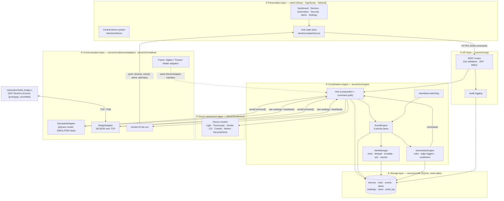

# Architecture

Vertex Home Hub is split into six layers with one-way dependencies. Each layer
lives in its own folder and can be tested in isolation.



## Layer responsibilities

| # | Layer | Code | Responsibility |
|---|---|---|---|
| 1 | Presentation | `client/src` | Themed console. Holds no business rules; every change is a validated REST call. Live state arrives over Socket.IO. |
| 2 | API | `server/src/api`, `server/src/auth` | Validates every request (Zod, `.strict()` schemas), authenticates (JWT HS256), authorises (admin > operator > viewer), audits failures. |
| 3 | Coordination | `server/src/engine` | Owns the command path, the priority event queue, automation, alerts and the heartbeat watchdog. |
| 4 | Device abstraction | `server/src/devices/Device.ts` | Pure, deterministic device models. `planCommand()` validates and returns the next state *without* mutating; `ingest()` applies a validated reading. |
| 5 | Communication | `server/src/devices/adapters`, `server/src/realtime` | Transports. Every adapter implements `DeviceAdapter` and pushes **untrusted** data through an `AdapterSink`. Socket.IO is server→client only. |
| 6 | Storage | `server/src/db` | SQLite schema + migrations (`PRAGMA user_version`), repositories, seed data. |

## The command path

```
UI ─POST /api/devices/:id/commands─▶ Zod schema ─▶ RBAC (operator+)
   ─▶ Hub.executeCommand
        1. device exists & online?            → 404 / 409
        2. device.planCommand(cmd)            → 422 if unsupported/invalid
        3. adapter.sendCommand(...)           → 409 if unreachable (no ack)
        4. device.commit(next) + persist
        5. publish device.command event       → event log, Socket.IO, automation
   ◀─ 200 { device }
```

State is committed **only after** the adapter accepts the command, so the UI
never shows a state the device did not acknowledge. Failures publish a
`device.command_failed` event and write an audit entry.

## The ingestion path

```
adapter ─raw reading─▶ ownership check (device belongs to this adapter?)
       ─▶ SensorReadingSchema (type + physical plausibility limits)
            ✗ → device.health = 'fault', audit 'denied', high-priority event
            ✓ → device.ingest() → persist reading → telemetry push
              → publish device.reading (low, or high for contact/motion)
              → EventEngine → AutomationEngine → AlertManager
```

## Event processing: asynchronous vs deterministic

The `EventEngine` keeps **four FIFO lanes** (`critical`, `high`, `normal`,
`low`). The drain loop always takes from the highest non-empty lane, in batches
scheduled with `setImmediate`, so a smoke alarm overtakes queued telemetry.
Under overload (10 000 queued) the oldest lower-priority event is shed first;
critical events are never displaced by lower ones.

This gives **ordering guarantees, not timing guarantees**:

| | This prototype (Node.js) | QNX Neutrino target |
|---|---|---|
| Scheduling | One event loop thread; cooperative. A slow handler delays everything behind it. | Preemptive, priority-based (`SCHED_FIFO`/`SCHED_RR`, 256 priorities). A higher-priority thread preempts a lower one immediately. |
| Priority | Logical only — chooses *which* event runs next. | Real — the OS runs the higher-priority **thread** first, including across processes. |
| Latency | Unbounded in theory: GC pauses, synchronous SQLite writes, I/O callbacks and the host OS all add jitter. Measured averages (shown in the UI) are typically sub-millisecond to tens of ms, but there is no worst-case bound. | Bounded and analysable: kernel timers deliver **pulses** at a chosen priority; message passing uses **priority inheritance** so a server works at its client's priority; mutexes inherit priority to avoid inversion. |
| Failure isolation | One process — a crash takes the whole hub down (mitigated by restart). | Microkernel — drivers and services are separate processes; a faulty driver can be restarted without touching the safety loop. |

**Practical consequence:** the Node.js hub is appropriate for coordination,
UI and non-critical automation. Anything that must react within a guaranteed
deadline (for example, cutting a gas valve on a CO alarm) belongs in a native
high-priority QNX process — see [`QNX_INTEGRATION.md`](QNX_INTEGRATION.md) and
`native/qnx/hubd_bridge.c`, where the safety interlock runs inside the
timer-driven sampler thread and never waits on the network.

## Automation semantics

| Trigger | Fires when | Notes |
|---|---|---|
| `motion` | A motion sensor reports `motion=true` | Cooldown per (rule, device). |
| `intrusion` | A contact sensor reports `open=true` | `requireArmed` checks the security panel mode. |
| `threshold` | A numeric reading crosses `op value` | **Edge-triggered**: fires on entering the region, re-arms after leaving. |
| `device_offline` | Watchdog misses heartbeats beyond `HEARTBEAT_TIMEOUT_MS` | Connectivity alerts auto-resolve on reconnect. |

Actions: `lights` (same room / named room / `*` all), `device_command`,
`raise_alert`, `activate_siren`. Actions call the same validated
`Hub.executeCommand` path as users do.

## Alert lifecycle

`active → acknowledged → resolved`. Open alerts are de-duplicated per
`(category, deviceId)`; a warning that receives a critical raise is
**escalated in place** (title, severity and message updated) rather than
duplicated. Every transition is persisted, audited and broadcast.

## Data model (SQLite)

| Table | Purpose |
|---|---|
| `users` | username, bcrypt hash, role — synchronised from `.env` at boot |
| `devices` | configuration + last known state (JSON) |
| `rules` | trigger/actions (JSON), cooldown, last fired |
| `events` | timestamped, prioritised event history (pruned to 20 000) |
| `alerts` | lifecycle with attribution (`acknowledged_by`, timestamps) |
| `readings` | numeric telemetry for charts (pruned to 24 h) |
| `audit_log` | logins, denied requests, failed commands, rejected readings |
