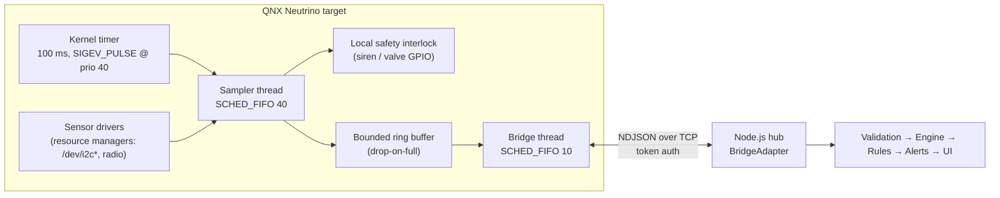

# QNX Neutrino integration

> **Status — read first.** No QNX Software Development Platform (SDP), QNX
> target, or physical sensor was available while building this project.
>
> | Item | Status |
> |---|---|
> | Node.js hub, web console, tests | Built and verified on Windows / Node 24 |
> | TCP bridge protocol (`BridgeAdapter`) | Verified by automated tests and a Node mock client (`scripts/mock-bridge.mjs`) |
> | `native/qnx/hubd_bridge.c` | **Written, not compiled, not run.** Uses documented QNX APIs; expect to fix details on a real SDP. |
> | Deployment on QNX hardware | **Not done.** No claim of successful QNX deployment is made. |
> | Zigbee / Thread / physical devices | **Not implemented.** Only the adapter boundary exists. |

## Why split the system

The Node.js hub is a good *coordinator* (UI, storage, rules, fan-out) but it
is not a real-time system: a single event-loop thread, garbage collection and
synchronous I/O mean there is **no worst-case latency bound** (see
[ARCHITECTURE.md](ARCHITECTURE.md#event-processing-asynchronous-vs-deterministic)).

QNX Neutrino is a microkernel RTOS with preemptive priority scheduling,
priority-inheriting message passing and kernel timers that deliver pulses at a
chosen priority. The intended deployment therefore puts the **time-critical
loop on QNX** and keeps the hub as the supervisory layer:



Key properties of `hubd_bridge.c`:

1. **Pulse-driven sampling.** `timer_create(CLOCK_MONOTONIC, SIGEV_PULSE…)`
   delivers a pulse to a private channel; `MsgReceivePulse` wakes the sampler
   at the pulse's priority. No polling, no drift from `sleep()`.
2. **Safety first, network last.** The interlock (`drive_siren`) is evaluated
   in the sampler thread — it never waits on the network or on Node.js.
3. **Priority separation.** The bridge thread runs at a lower priority and is
   the only code touching sockets. The ring buffer never blocks the sampler;
   overflow drops frames and counts them.
4. **Priority inheritance.** QNX mutexes inherit priority by default, so the
   short critical section shared by both threads cannot cause unbounded
   priority inversion.
5. **Honest data labelling.** With `SIMULATED_SENSORS=1` (default) the hello
   frame declares `"simulated": true`; the hub marks every resulting device,
   event and alert as simulated.

## Building the native prototype (unverified)

```bash
# On a host with QNX SDP 7.1 or 8.0 installed
source ~/qnx800/qnxsdp-env.sh          # or qnxsdp-env.bat on Windows
cd native/qnx
make                                    # x86_64 target  -> build/hubd_bridge
make TARGET=aarch64le                   # ARM64 target
# copy build/hubd_bridge to the target (e.g. via QNX Momentics or scp)
```

On the hub machine, enable the bridge in `server/.env`:

```ini
BRIDGE_ENABLED=true
BRIDGE_HOST=0.0.0.0        # listen on the LAN interface the QNX target can reach
BRIDGE_PORT=7400
BRIDGE_TOKEN=<long random token>
```

On the QNX target:

```bash
./hubd_bridge -h <hub-ip> -p 7400 -t <BRIDGE_TOKEN>
```

`make posix` builds the same file with gcc/clang on Linux/macOS for protocol
testing only (the POSIX fallback is **not** deterministic).

### Trying the boundary without QNX (verified)

```bash
# terminal 1 - start the hub with BRIDGE_ENABLED=true in server/.env
npm run dev
# terminal 2 - Node stand-in for the native process
BRIDGE_TOKEN=<token from server/.env> node scripts/mock-bridge.mjs 127.0.0.1 7400
```

Three `QNX …` devices appear on the Devices page (origin **bridge**, labelled
SIM because the mock declares simulated data); commands to *QNX Garage Light*
round-trip through the socket and are acknowledged.

## Bridge protocol

Newline-delimited JSON over TCP; max 4 KiB per frame; client must authenticate
within 5 s.

| Direction | Frame |
|---|---|
| → hub | `{"type":"hello","token":"…","node":"qnx-node-1","simulated":false}` |
| ← hub | `{"type":"welcome"}` or `{"type":"error","error":"unauthorized"}` (then close) |
| → hub | `{"type":"announce","device":{"id":"qnx-co-1","name":"…","kind":"co","room":"Garage"}}` |
| → hub | `{"type":"reading","deviceId":"qnx-co-1","reading":{"metric":"co_ppm","value":4.2}}` |
| → hub | `{"type":"heartbeat","deviceId":"qnx-co-1"}` |
| ← hub | `{"type":"command","id":"<uuid>","deviceId":"qnx-light-1","command":{"action":"setPower","on":true}}` |
| → hub | `{"type":"ack","id":"<uuid>","ok":true}` (or `"ok":false,"error":"…"`) |

Hub-side guarantees (`server/src/devices/adapters/BridgeAdapter.ts`):

* constant-time token comparison; unauthenticated sockets are closed;
* every frame schema-validated; malformed/oversized frames dropped and audited;
* readings only accepted for devices **this session announced**, and a bridge
  can never write to a device owned by another adapter (no spoofing of the
  simulator's devices);
* readings pass the same plausibility limits as every other adapter;
* commands time out after 3 s → `409` to the caller and a `device.command_failed` event.

**Transport security:** the prototype protocol is plain TCP. On anything
other than an isolated lab network, wrap it in TLS (e.g. stunnel/WireGuard)
or replace it with a QNX-supported secure channel before use.

## Alternative QNX integration patterns

| Pattern | When to use |
|---|---|
| **Resource manager** (`/dev/smarthub`) — expose devices as a path, accept `devctl()` commands | Other QNX processes need to control devices with POSIX calls |
| **Native message passing** (`MsgSend`/`MsgReceive`) between driver and coordinator processes | All-QNX deployment; you want priority inheritance end-to-end |
| **Node.js on QNX** — run this hub directly on the target and keep only drivers native | Single-box deployment; accept that the Node portion is still not real-time |
| **TCP/NDJSON bridge** (implemented) | Hub on a separate Linux/Windows machine, QNX as the real-time edge |

## Future physical connectivity (Zigbee / Thread / Matter)

Add a class implementing `DeviceAdapter`
(`server/src/devices/adapters/DeviceAdapter.ts`):

```ts
export class ZigbeeAdapter implements DeviceAdapter {
  readonly id = 'zigbee';
  readonly origin = 'bridge';               // add a new DataOrigin if preferred
  async start(sink: AdapterSink) { /* open coordinator (e.g. via zigbee2mqtt / MQTT) */ }
  async stop() { /* close */ }
  async sendCommand(device, command) { /* map DeviceCommand → cluster command; await ack */ }
  status() { return { connected: true, detail: '…' }; }
}
```

and register it in `server/src/app.ts` with `hub.addAdapter(...)`. The hub's
validation, ownership checks, automation, alerts, storage and UI need no
changes. On QNX, the radio stack itself would typically run as a resource
manager process feeding `hubd_bridge`.

## Safety statement

Even on QNX, this software is **not** a certified life-safety system. Real
smoke/CO alarms must meet the applicable standards (e.g. EN 14604 / UL 217,
EN 50291 / UL 2034) and intrusion systems require certified hardware and
monitoring. Keep certified, independently powered alarms installed regardless
of any hub integration.
